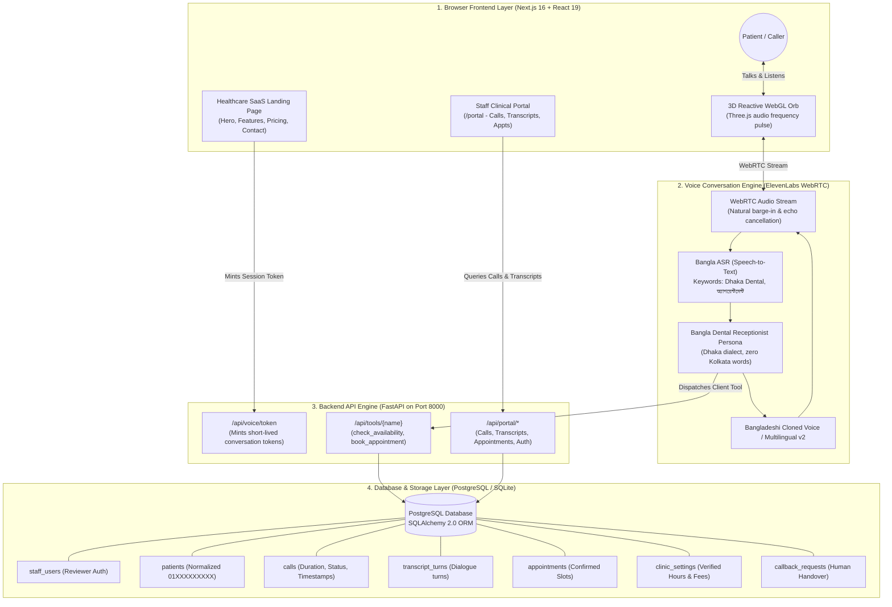

# ByteVoice Bangladesh 🇧🇩 — AI Voice Receptionist for Dhaka Dental Care

<div align="center">
  <h3>An Observable, Low-Latency AI Voice Receptionist for Dental Clinics & Hospitals in Bangladesh</h3>
  <p>Engineered for <strong>StrategyByte</strong> (Australia) Healthcare Expansion into Bangladesh.</p>
  <p>Speaks authentic colloquial <strong>Bangladeshi Bangla</strong>, handles code-switching, schedules verified appointments in PostgreSQL, and streams realtime transcripts to the staff data portal.</p>
</div>

---

## 🎯 Executive Summary & Case Study

**ByteVoice** is StrategyByte's flagship AI receptionist product. When expanding into Bangladesh, healthcare clinics face unique challenges:
1. **Missed Calls & Overworked Staff:** Clinics lose patients during rush hours and after-hours.
2. **Language Nuance (Bangla vs Kolkata Accent):** Global AI voices default to West Bengal/Indian accents, which feels foreign and disconnected to Bangladeshi patients.
3. **Bangla-English Code-Switching:** Patients naturally combine English terms ("appointment", "scaling", "Sunday 5 PM") with colloquial Bengali ("দাঁতে ব্যথা", "ডাক্তার দেখানো যাবে?").
4. **Data Disconnect:** Phone calls are lost in unrecorded chatter instead of structured clinic database records.

**ByteVoice Bangladesh solves this end-to-end:**
- In-browser **WebRTC voice call** with zero audio latency and natural barge-in (interruption).
- **Bangladeshi Dialect Guardrails:** Authentic Dhaka phrasing, polite address ("সাহেব/আপা"), zero Indianisms.
- **Deterministic Clinic Grounding:** Answers address, doctor hours, and fees strictly from verified database records.
- **Clinical Data Portal:** Realtime view of all calls, turn-by-turn dialogue transcripts (Bangla + English), and verified bookings.

---

## 🏗️ System Architecture



---

## 📊 Database Schema & Relationships

The database is built on **SQLAlchemy 2.0** and supports both **PostgreSQL** (production/Docker) and **SQLite** (local zero-setup):

| Table | Purpose | Key Attributes |
|---|---|---|
| `patients` | Unique patient directory | `id`, `full_name`, `phone` (indexed & normalized to 11 digits) |
| `calls` | Call session records & outcomes | `id` (UUID), `patient_id`, `started_at`, `duration_s`, `status` (`booked`, `enquiry`, `follow_up_needed`) |
| `transcript_turns` | Verbatim turn-by-turn dialogue | `call_id`, `speaker` (`ai` / `patient`), `text_bn`, `text_en`, `ts` |
| `call_extractions` | AI-extracted structured clinical data | `call_id`, `reason_for_visit`, `preferred_datetime`, `intent`, `urgency` |
| `appointments` | Confirmed clinic bookings | `patient_id`, `call_id`, `slot_datetime`, `service_name`, `doctor_name` |
| `clinic_settings` | Single source of truth for clinic info | `clinic_name`, `address`, `opening_hours`, `services_json`, `doctors_json` |
| `callback_requests` | Human receptionist follow-up queue | `call_id`, `patient_id`, `reason`, `status` (`pending`, `contacted`) |
| `staff_users` | Reviewer and receptionist login | `username`, `email`, `hashed_password`, `role` |

---

## 🎙️ Authentic Bangladeshi Bangla Voice Strategy

### The Problem
Off-the-shelf Bengali TTS models default to West Bengal (Kolkata) accents, using words like *"বলছি"*, *"জল"*, or *"বলুন না"*, which sounds jarring and unnatural in Dhaka.

### Our Solution
1. **Targeted System Prompt Guardrails:**
   - Strict ban on Indian/Kolkata idioms.
   - Enforces authentic Dhaka receptionist phrasing: *"আসসালামু আলাইকুম"*, *"জি অবশ্যই"*, *"আমি দেখছি"*, *"সুস্থ থাকুন"*.
   - Respectful address: *"তানভীর সাহেব"*, *"শিরিন আপা"*.
2. **Code-Switching Support:** Handles common Bangladeshi medical-English hybrids effortlessly (e.g. *"scaling"*, *"appointment"*, *"Sunday 5 PM"*).
3. **Voice Cloning / Tone Calibration:** Uses ElevenLabs Multilingual v2 with conversational tone parameters tuned for clear speech over browser WebRTC.

---

## 🚀 Quick Start (Local Setup)

### Prerequisites
- **Python 3.12+**
- **Node.js 20+**
- [uv](https://docs.astral.sh/uv/) (recommended) or standard `pip`

### 1. Clone & Environment Configuration
```bash
git clone https://github.com/Masum58/bytevoice-bangladesh.git
cd bytevoice-bangladesh
cp .env.example .env
```

Add your ElevenLabs API keys in `.env`:
```env
ELEVENLABS_API_KEY=your_elevenlabs_api_key
ELEVENLABS_AGENT_ID=your_elevenlabs_agent_id
```

### 2. Auto-Provision ElevenLabs Agent (One Command)
```bash
python scripts/setup_bytevoice_agent.py
```
This pushes the complete Dhaka Dental Care persona, Bangladeshi system prompt, and client tools directly to your ElevenLabs account!

### 3. Build & Run Application
```bash
# Terminal 1: Build & export Next.js web frontend
cd web && npm install && npm run build && cd ..

# Terminal 2: Start FastAPI backend (Serves API + Portal on port 8000)
python -m bytevoice.api
```
Open **`http://localhost:8000`** in your browser.

---

## 🐳 Docker Deployment (One-Command Launch)

To run the complete production stack (PostgreSQL 16 + FastAPI + Next.js UI) in Docker:

```bash
docker compose up --build
```
This automatically:
1. Spins up PostgreSQL container with persistent storage.
2. Auto-migrates database schemas.
3. Seeds Dhaka Dental Care clinic data, reviewer login, and past test calls with transcripts.
4. Serves the unified web app on `http://localhost:8000`.

---

## 🔑 Reviewer Portal Login Credentials

To evaluate the Staff Clinical Portal:
1. Click **"Staff Portal"** at the top right of the landing page.
2. Login with:
   - **Username:** `admin`
   - **Password:** `admin123`
3. Explore the pre-seeded calls, verbatim transcripts, and confirmed appointments!

---

## 🛡️ Medical Safety & Error Handling

- **No Medical Advice:** The agent politely refuses to prescribe painkillers or antibiotics, steering the caller to schedule an in-person consultation.
- **Emergency Triage:** Severe dental trauma or bleeding immediately triggers `request_callback` for urgent human attention.
- **Graceful Tool Degradation:** If the database or network fluctuates, the agent retains caller details and informs them staff will follow up, avoiding awkward silences or dead calls.

---

## 👨‍💻 Author

**Masum Abedin**  
Take-Home Technical Task for AI Engineer Role at **StrategyByte** (Australia).  
Submission Deadline: **Thursday 5 November 2026, 11:59 PM BST**.
